# Retirement Planner

A desktop (wxPython + Plotly) year-by-year retirement planning model.

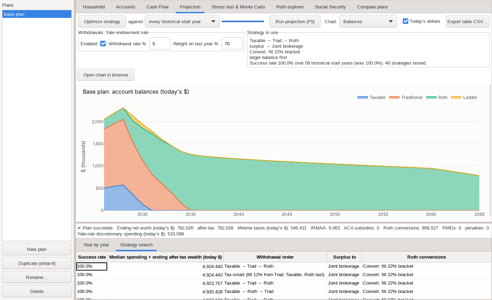

## Setup

```bash
# Debian/Ubuntu/elementary: wxPython comes from the distro (no PyPI wheels for Linux)
sudo apt install python3-wxgtk4.0 python3-wxgtk-webview4.0   # webview = charts inside the app
python3 -m venv --system-site-packages .venv
.venv/bin/pip install -r requirements.txt
.venv/bin/python main.py                          # opens with an example plan
.venv/bin/python main.py examples/example_workspace.json
.venv/bin/python -m pytest -q                     # engine tests
```

Without `python3-wxgtk-webview4.0` the app still works; each chart opens in your web browser instead.

## Screenshots

All screenshots use the built-in example plan (File → Load example plan), after Optimize strategy has run.

| | |
|---|---|
| 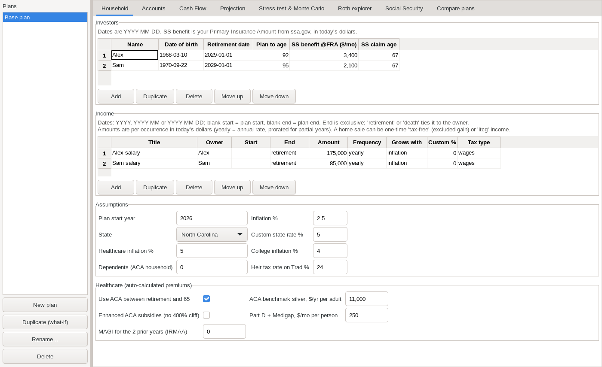 **Household**: investors, income and assumptions | 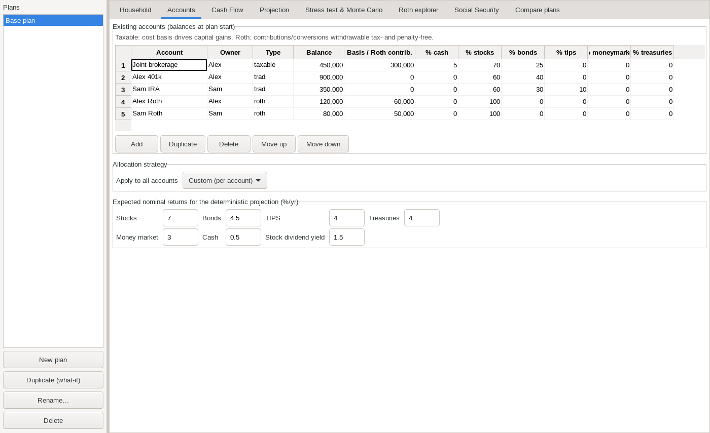 **Accounts**: balances, tax type and allocation |
| 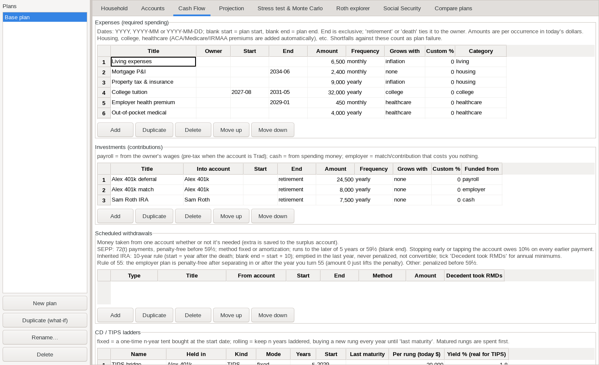 **Cash Flow**: expenses, investments, scheduled withdrawals and ladders | 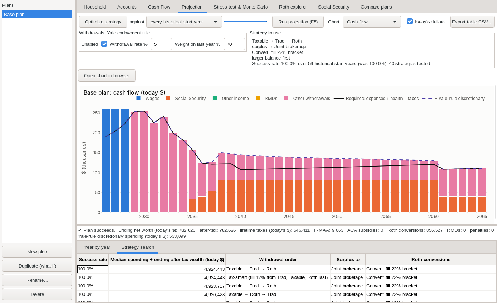 **Projection**: cash flow, with the strategy search results |
| 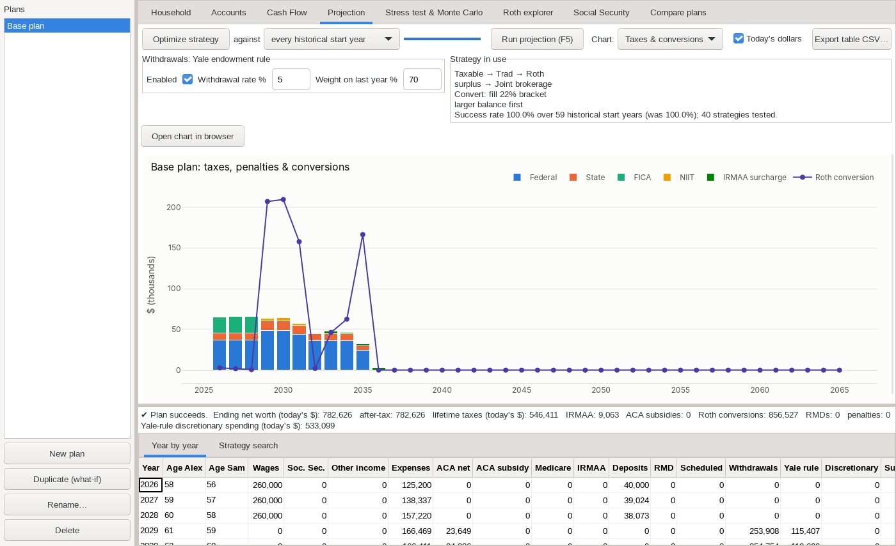 **Projection**: taxes and Roth conversions | 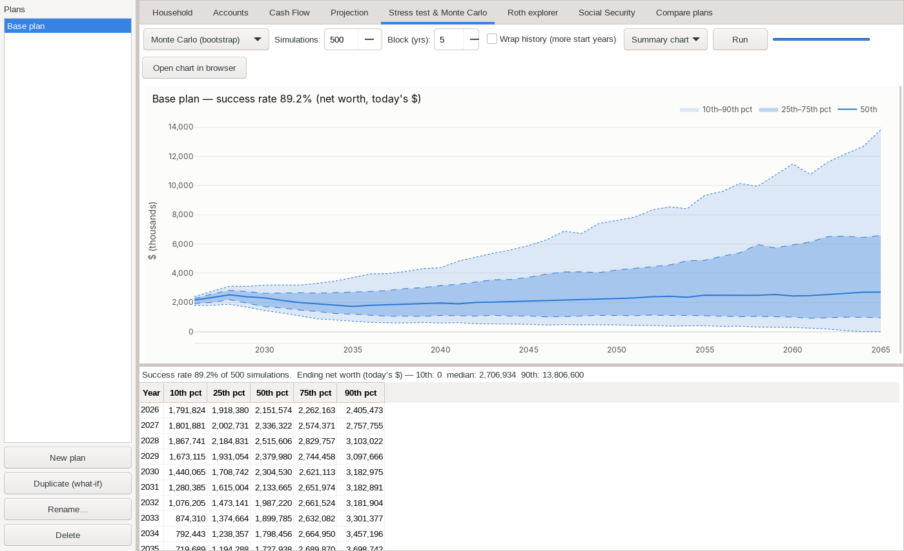 **Monte Carlo**: net worth percentile bands |
| 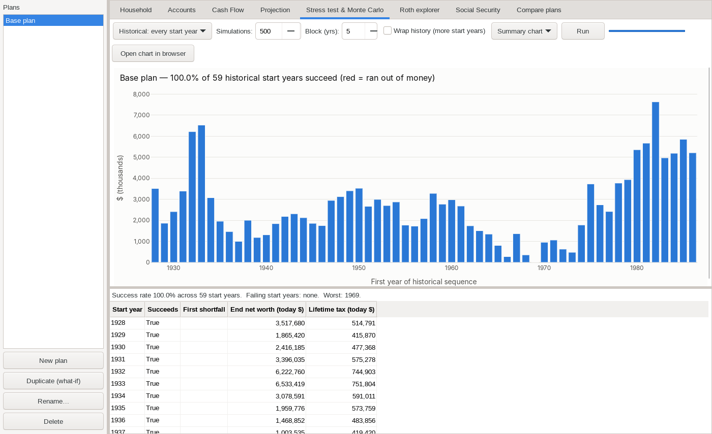 **Historical**: every start year since 1928 | 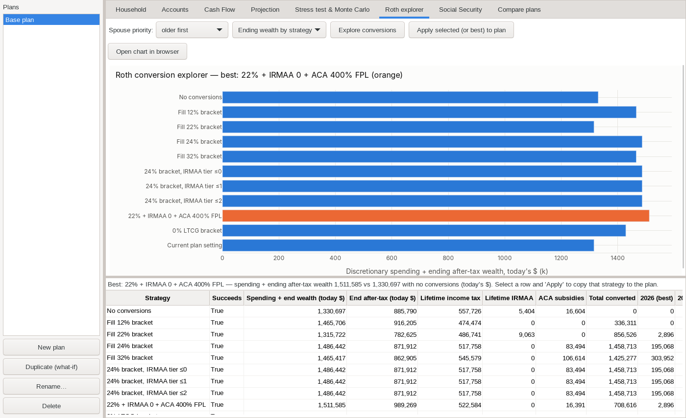 **Roth explorer**: conversion strategies compared |
| 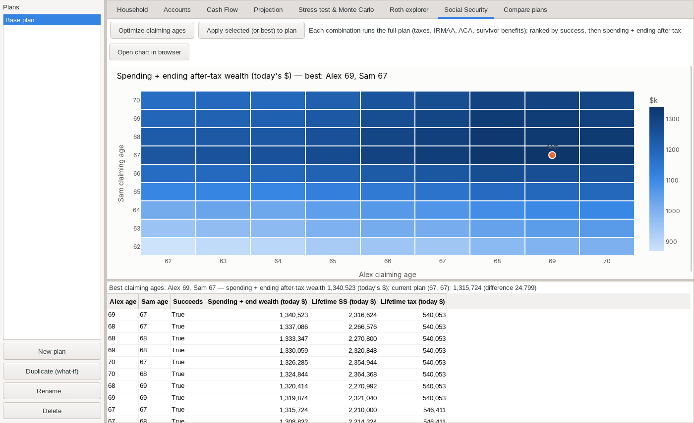 **Social Security**: claiming-age heatmap for both spouses | 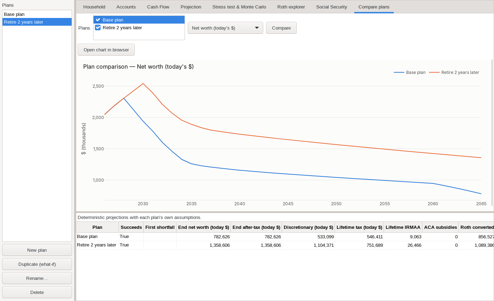 **Compare plans**: base plan vs. a what-if copy |

To regenerate them: `xvfb-run -a -s "-screen 0 1400x900x24" .venv/bin/python tools/screenshots.py`

## Using it

* **Household**: investors (DOB, retirement date, plan-to age, Social Security PIA and claim age), **Income**, inflation, state, ACA/Medicare.
* **Accounts**: taxable / trad / roth balances at the start date, cost basis, allocation across cash, stocks, bonds, TIPS, money market and Treasuries, or a 60/40 … 100/0 preset for every account.
* **Cash Flow**: four tables. **Expenses** (and **Income**, on the Household tab) hold dated items with start/end dates, frequency (one-time, weekly, bi-weekly, monthly, yearly) and indexing (CPI, healthcare, college, custom % or none). End dates are exclusive. Use `retirement` or `death` to tie an item to its owner. **Investments** holds contributions (payroll/pre-tax, cash, employer). **Scheduled withdrawals** take money from one account whether or not it's needed (the extra goes to the surplus account). Each row has a type:
  * *SEPP* (72(t)): penalty-free payments before 59½. Use a fixed nominal amount or the amortization method (Amount = interest rate, 0 = 5%, single-life table). Payments run until the later of 5 years or 59½ (blank end). The account is locked: no other withdrawals and no Roth conversions. Ending early, or drawing on the account to cover required spending, owes 10% on every earlier payment.
  * *Inherited IRA*: 10-year rule. Start = the year after the death, blank end = start + 10. The account is emptied in its last year. It is never penalized, is not part of the owner's own RMDs, and can't be converted. Tick *Decedent took RMDs* for annual single-life minimums. Method: minimum, even (spread to the deadline), fixed or percent (never below the minimum).
  * *Rule of 55*: the employer plan becomes penalty-free from the owner's retirement date, if that is in or after the year they turn 55 (not an IRA; the age-50 public-safety rule is not modeled). Amount 0 just lifts the penalty and lets the withdrawal order use the account.
  * *Other*: a plain fixed or percent withdrawal, penalized before 59½.
* **CD / TIPS ladders** can be a fixed n-year tent or a rolling ladder.
* **Projection**:
  * *Withdrawals* follow the **Yale endowment rule**. The first retirement year withdraws 5% of the portfolio. After that: 0.3 × (5% × portfolio) + 0.7 × last year's withdrawal × (1 + inflation). The rate and the 70% weight are editable. The rule starts once every investor is retired. Required expenses and taxes are always paid, even when they exceed the rule's amount. Rule money beyond them is discretionary spending. Cash beyond the rule's budget (wages, RMDs above it) is saved to the surplus account.
  * *Optimize strategy* searches withdrawal order, surplus account, Roth conversion rule (bracket fill, IRMAA tier, 0% LTCG, ACA % FPL) and spouse conversion priority. Each candidate runs through every historical start year (or a fixed Monte Carlo sample). Candidates are ranked by success rate, then median discretionary spending + ending after-tax wealth. The search is coordinate descent, about 40 strategies in under a minute. The winning strategy is applied to the plan and projected.
  * Charts (balances, cash flow incl. RMDs, taxes, healthcare) and a year-by-year table you can export to CSV.
* **RMDs**: Uniform Lifetime Table, starting at age 73 (born 1951–59) or 75 (1960+). Each owner's RMD is based on the total of their Trad balances on Dec 31 of the prior year. It can come from any of those accounts, including selling ladder rungs. It is taken before conversions (an RMD can't be converted). The portion beyond spending needs is reinvested in the surplus account.
* **Stress test & Monte Carlo**: every historical start year since 1928 (ficalc-style), block-bootstrap Monte Carlo, and named crisis periods.
* **Roth explorer**: compares conversion strategies in the deterministic projection: spending + ending after-tax wealth, lifetime tax, IRMAA and ACA subsidies.
* **Social Security**: grid search of claiming ages 62–70 for both spouses, each run through the full plan.
* **What-if / Compare**: duplicate a plan, change it, then overlay plans on one chart.

## Model notes and simplifications

* Annual time step. Flows happen at the start of the year, then growth. Taxes are solved together with the withdrawals that pay them.
* Federal tax uses 2026 brackets (OBBBA), indexed by the simulated CPI. It covers the standard deduction plus the 65+ and 2025–28 senior deductions, LTCG stacking, SS taxation, NIIT, FICA and the 10% early-withdrawal penalty (with the SEPP, inherited-IRA and Rule of 55 exceptions above). No itemized deductions.
* State taxes are simplified tables for a handful of states plus a custom flat rate. Check them against your state's rules.
* Social Security: early/late claiming factors, spousal top-up, survivor benefit, COLA = CPI. No earnings test.
* Medicare Part B/D IRMAA uses MAGI from two years earlier. ACA premium tax credit uses the post-2025 schedule (400% FPL cliff). "Enhanced" toggles the ARPA schedule.
* The joint-life RMD table (spouse more than 10 years younger) is not modeled. Inherited IRAs follow the non-spouse 10-year rule (no spousal rollover, no eligible-designated-beneficiary stretch). SEPP recapture omits the IRS interest charge.
* Roth basis tracks contributions and conversions (the 5-year rule is not modeled).
* Taxable accounts: stock dividends are taxed as qualified, and positive non-stock returns as interest (Treasury interest is state-exempt). Withdrawals realize gains pro-rata to basis.
* Historical data (`retire/data/historical_returns.csv`) approximates the Damodaran annual series (S&P 500, T-bill, 10-yr Treasury, CPI). Bonds, TIPS and cash are proxies built from those series. The 2025 row is an estimate. Replace the file to use your own data.
